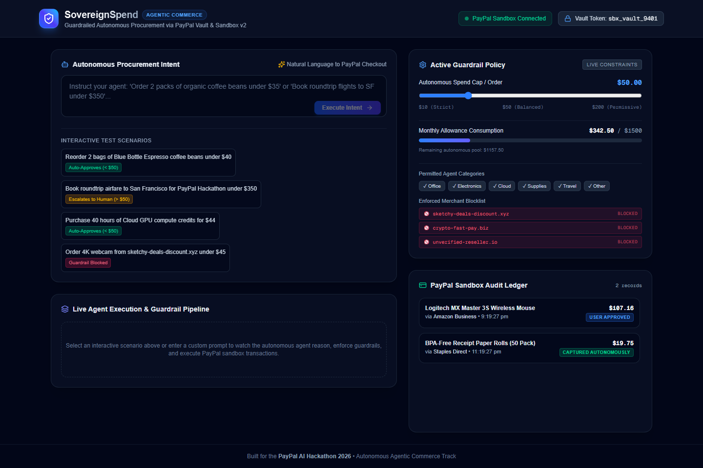
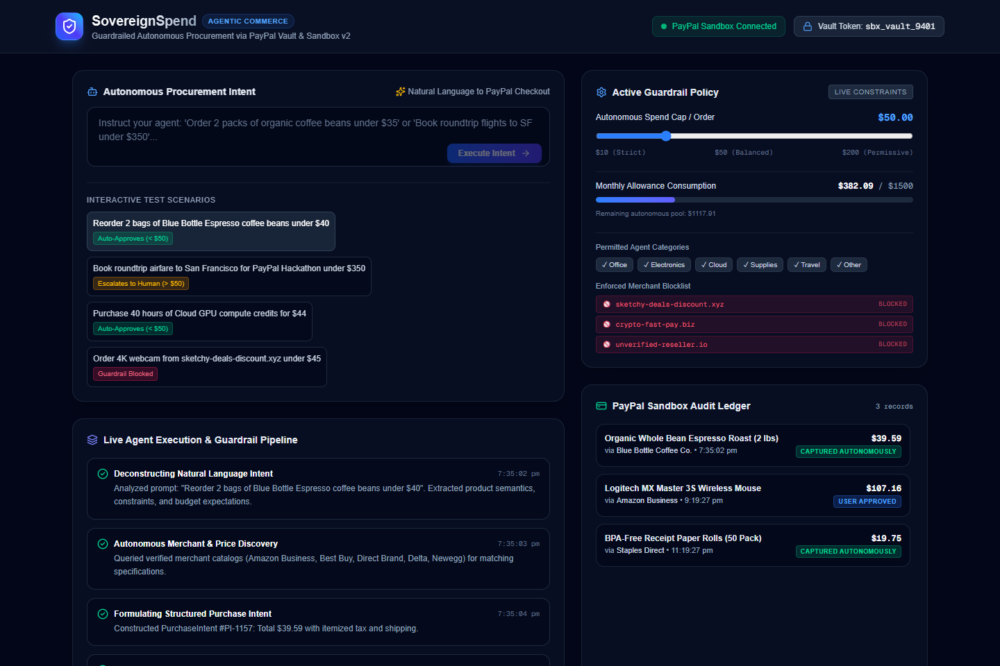
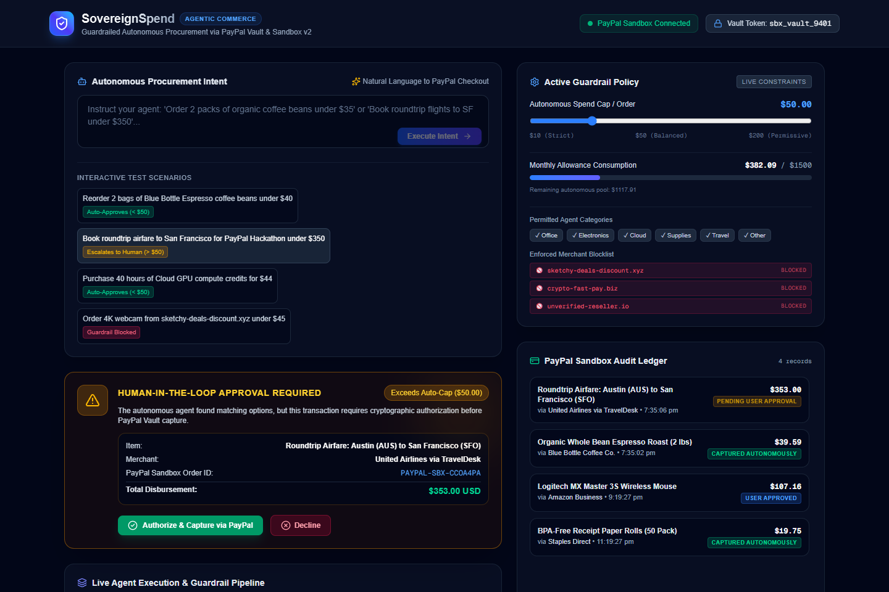
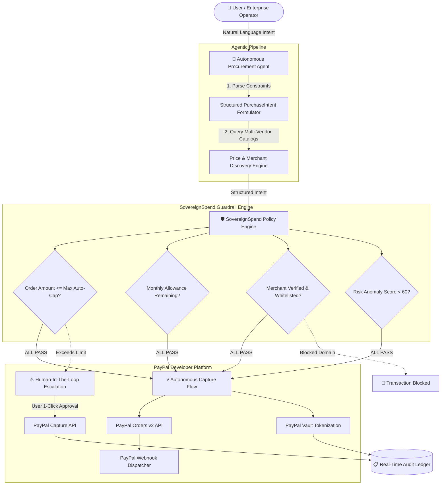

# 🛡️ SovereignSpend — Guardrailed Autonomous Agent Commerce

<p align="center">
  
</p>

<p align="center">
  <strong>Give autonomous AI agents a real wallet with smart budget guardrails, merchant verification, and secure PayPal Vault disbursement.</strong>
</p>

<p align="center">
  <a href="https://nextjs.org/"></a>
  <a href="https://developer.paypal.com/"></a>
  <a href="https://www.typescriptlang.org/"></a>
  <a href="https://tailwindcss.com/"></a>
  <a href="https://github.com/adarsh-panicker"></a>
</p>

---

## 📌 Submission Overview

* **Hackathon:** [PayPal AI Hackathon 2026 (Devpost)](https://paypalaihackathon.devpost.com/)
* **Category / Target Track:** **Best Use of Agentic Commerce** & **Best Use of PayPal + AI**
* **Author & Lead Developer:** [Adarsh Panicker](https://github.com/adarsh-panicker)
* **Code Repository:** Public Git Repository with MIT License

---

## 🚨 The Problem

Autonomous AI agents (such as browser bots, executive assistants, and automated procurement systems) can research products, compare prices, and negotiate terms. However, **the catastrophic bottleneck in agent autonomy is financial custody**:
1. **Unrestricted Credit Access:** Handing an LLM raw card numbers or unfettered checkout access creates fatal vulnerabilities to prompt injection, hallucinated overspending, and unauthorized subscriptions.
2. **Lack of Merchant Verification:** Autonomous scrapers can easily fall victim to rogue vendors, phishing domains, or price-gouging resellers.
3. **All-or-Nothing Spending:** Current systems lack granular budget sandboxing, forcing humans to manually review every single \$10 coffee reorder or risk an unchecked \$1,000 charge.

---

## 💡 The Solution: SovereignSpend

**SovereignSpend** is an autonomous procurement and guardrail orchestration engine that pairs multi-agent product discovery with a programmable policy engine and **PayPal's Sandbox v2 & Vault APIs**.

With SovereignSpend:
* **Micro-transactions (< \$50 limit)** within policy are verified, checked against merchant whitelists, and **autonomously captured** via tokenized PayPal Vault agreements without human friction.
* **High-value purchases (> \$50 limit) or anomalous risk items** are automatically intercepted by the Guardrail Engine, generating a **1-click Human-In-The-Loop cryptographic authorization card** before funds are disbursed.
* **Blocked or unverified merchants** are instantly rejected by the policy engine before any PayPal order can be initiated.

---

## 📸 Screenshots & Live Interface

### 1. SovereignSpend Command Center
> Dynamic prompt bar, real-time spending velocity tracker, and active PayPal Vault connection.


### 2. Autonomous Agent Execution Pipeline (< $50)
> Natural language intent decomposition, catalog pricing discovery, guardrail policy compliance, and automated PayPal Vault disbursement.


### 3. Human-In-The-Loop Authorization Card (> $50)
> High-value orders pause execution and request expedited 1-tap administrator authorization before capturing PayPal Sandbox funds.


---

## 🏛️ System Architecture



---

## ⚙️ Deep PayPal Integrations

| PayPal Feature / API | How SovereignSpend Uses It |
| :--- | :--- |
| **PayPal Orders v2 (`/v2/checkout/orders`)** | Generates compliant purchase units with itemized unit pricing, shipping, tax breakdowns, and metadata tracking. |
| **PayPal Vault (`/v3/vault/payment-tokens`)** | Stores tokenized payer agreements so autonomous agents never handle raw credentials or card details. |
| **PayPal Capture API (`/v2/checkout/orders/{id}/capture`)** | Executes programmatic settlement upon policy auto-approval or human cryptographic sign-off. |
| **Dual-Engine Architecture** | Supports live PayPal Sandbox credentials while maintaining high-fidelity simulated fallback schemas so anyone can test instantly. |

---

## 🏆 Interactive Hackathon Test Scenarios

Try these scenarios directly using the interactive prompt chips in the dashboard:

| Test Scenario | Sample Prompt | Expected Pipeline Behavior |
| :--- | :--- | :--- |
| **Micro-Procurement** | *"Reorder 2 bags of Blue Bottle Espresso coffee beans under $40"* | 🟢 **Autonomous Capture** — Passes \$50 cap, verified vendor, captures via PayPal Vault in ~1.2s. |
| **High-Value Travel** | *"Book roundtrip airfare to San Francisco under $350"* | 🟡 **Human-In-The-Loop** — Pauses order, generates approval card with order breakdown. Captures on user click. |
| **Cloud API Compute** | *"Purchase 40 hours of Cloud GPU compute credits for $44"* | 🟢 **Autonomous Capture** — Categorized as digital goods, passes policy, captures via PayPal Sandbox. |
| **Malicious Domain** | *"Order 4K webcam from sketchy-deals-discount.xyz under $45"* | 🔴 **Guardrail Blocked** — Domain blocklist triggers immediate rejection; no order is created. |

---

## 🛠️ Tech Stack

* **Framework:** Next.js 16.4.3 (App Router, Turbopack, React 19)
* **Language:** TypeScript 5.0
* **Styling:** Tailwind CSS v4 & Lucide Icons
* **Payments:** PayPal REST APIs (v2 Orders, Vault, Webhooks)
* **Architecture:** In-Memory Audit Ledger & Policy Store with RESTful API routes
* **Browser Automation:** Headless Edge & Puppeteer-core for UI verification

---

## 🚀 Quickstart & Installation

### 1. Clone the Repository
```bash
git clone https://github.com/adarsh-panicker/sovereign-spend.git
cd sovereign-spend
```

### 2. Install Dependencies
```bash
npm install
```

### 3. Configure Environment Variables (Optional)
Copy `.env.example` to `.env.local`:
```bash
cp .env.example .env.local
```
Add your PayPal Sandbox keys from the [PayPal Developer Dashboard](https://developer.paypal.com/dashboard/):
```env
PAYPAL_CLIENT_ID=your_paypal_sandbox_client_id
PAYPAL_CLIENT_SECRET=your_paypal_sandbox_client_secret
PAYPAL_API_BASE=https://api-m.sandbox.paypal.com
```
*(Note: If no keys are provided, SovereignSpend automatically runs in simulated Sandbox mode with full fidelity).*

### 4. Run Development Server
```bash
npm run dev
```
Open **[http://localhost:3000](http://localhost:3000)** in your browser.

---

## 🛡️ Security & Guardrail Philosophy

1. **Least-Privilege Financial Delegation:** Agents only receive scoped, revocable allowances.
2. **Intent Verification:** Multi-stage parsing checks whether item descriptions match the prompt's semantic category.
3. **Domain Blocklists:** Prevents agents from transacting with unauthorized or unverified domains.
4. **Transparent Audit Trails:** Every autonomous disbursement logs the reasoning, timestamp, and PayPal transaction IDs.

---

## 👨‍💻 Author

**Adarsh Panicker**  
* GitHub: [@adarsh-panicker](https://github.com/adarsh-panicker)  
* Project: [SovereignSpend](https://github.com/adarsh-panicker/sovereign-spend)  
* Event: PayPal AI Hackathon 2026

---

## 📜 License
This project is open-source under the [MIT License](LICENSE).
